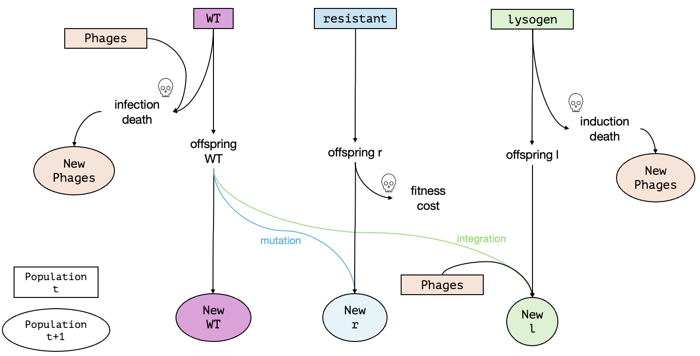

**Authors:** Aylin & Marika
**Date:** 28.10.2026
**Context:** Theoretical Ecology and Evolution Practical 

# Resistance vs. lysogeny: bacterial defense against temperate phages under phage therapy

## About this project
Stochastic, discrete-time simulation of a bacterial population exposed to temperate phages. Bacteria can survive in two ways:
- Resistance: slow but permanent (rare mutation, growth cost)
- Lysogeny: fast but risky. A phage integrates a wild-type cell which becomes a lysogen (= a bacterium that carries the dormant genome of a temperate phage). The prophage can later be induced and kill the cell.
The model extends the basic evolutionary rescue model based on Orr & Unckless (2008) introduced in the Theoretical Ecology and Evolution Practical (Bank 2026).

The projects includes iterations of the simulation with varied parameters. Plots can be generated to visualize the outcomes of the iterations.

## Idea of the model
Our model describes a bacterial population that is suddenly exposed to phages, as in phage therapy. In the new environment the wild-type (wt) bacteria are unfit, because phages infect and kill them. The population can only be rescued if some bacteria acquire a way to survive the phages. We compare two such strategies: resistance, which is independent of the phages and lysogeny, which is phage-dependent.
The model asks how the two strategies perform under different conditions and when the population goes extinct. 

## Project structure
```
project/
├── README.md                  this file
└── THEE_bacteria_phage.Rmd    main notebook (model, simulations, plots)
└── data                       folder with data generated for analysis                      
```

| Piece | What it does |
|---|---|
| `simulate_one_gen()` | Simulates one generation: infection/induction losses, Poisson offspring with logistic growth, multinomial split of wild-type offspring into resistant / lysogenic / wild type, phage update |
| `simulate_pop()` | Repeats `simulate_one_gen()` until extinction or `t_max` and returns population sizes per generation |
| Plot chunk | Plots wild type, resistant, lysogens, phages and total population (ggplot2) |
| Analysis chunk | Runs many replicates over a parameter range and summarizes the outcome |

## Requirements 
- R and RStudio
- R packages: "ggplot2", "tidyr", "dplyr", "tibble"

```r
install.packages(c("ggplot2", "tidyr", "dplyr", "tibble"))
```

## How to run
1. Open "THEE_bacteria_phage.Rmd" in RStudio.
2. Run the chunks from top to bottom, or click "Knit" for an HTML report.
3. Change the parameters in the "population trajectory" chunk to explore other scenarios. 
4. Change the parameters in the "iterations" chunks to analyze simulation outcomes under different conditions.
The analysis chunk runs many replicates and can be slow.

## Model overview: strategies and outcomes

The model is as follows: a haploid bacterial population starts with a given number of wild-type (wt) bacteria and a fixed growth rate together with a population of free phages. Because of the phages, the wild-type is unfit: in each generation wt bacteria are killed by phage infection and the more phages there are, the higher the death rate of the wild-type.
The following are the two possible survival strategies that the bacteria population have:

1. Resistance (slow but safe): wt offspring have a resistance mutation at a low rate (`mut_rate`). Resistant bacteria are immune to the phages and are not killed by infection. Resistance is permanent, but it comes with a fitness cost (`cost_r`) that reduces their offspring number. This strategy is phage-independent. 

2. Lysogen (fast but risky): wt bacteria can enter a lysogenic relationship with the phage (`lysogen_prob`), which becomes more likely the more phages are present. Lysogenic bacteria carry a dormant phage and therefore cannot die from infection. However, they can later be killed by induction of the dormant phage (`induction_prob`), which releases new phages into the environment. This strategy is phage-dependent.

Figure 1 shows a schematic of one generation. Not depicted are the rates and probabilities leading to each new population (i.e., `growth_rate`, `mut_rate`, `cost_r`, `induction_prob` etc.). 


*Figure 1: Life cycle of one generation in the model*

All bacterial types grow with a shared carrying capacity (`K`) and the phage population is updated each generation from phage decline (`P_decline`) and from phage production at infection and induction events (`P_prod`). Resistant and lysogenic bacteria start at a population number of 0, so they have to arise from wt bacteria through mutations or integration (i.e., becoming a lysogen) and then spread before the total bacterial population goes extinct. Rescue means that the bacterial population (be it wt, resistant or lysogen) recovers and persists. 

The following are the three possible outcomes of our model:
1. Extinction
2. Only lysogen persists
3. Only resistance persists

## Variables and Parameters
| Name | Type | Description | Allowed range | Value |
|:-----|:-----|:------------|:--------------|:------|
| $N_{wt}$ | State variable | Current size of the wild-type bacteria population | integer ≥ 0 | changes over time |
| $N_r$ | State variable | Current size of the resistant bacteria population | integer ≥ 0 | changes over time |
| $N_l$ | State variable | Current size of the lysogenic bacteria population | integer ≥ 0 | changes over time |
| $N_P$ | State variable | Current size of the phage population | ≥ 0 | changes over time |
| `N_init_wt` | Initial condition | Initial size of the wild-type population | positive integer | 100 |
| `N_init_r` | Initial condition | Initial size of the resistant mutant population | integer ≥ 0 | 0 |
| `N_init_l` | Initial condition | Initial size of the lysogenic population | integer ≥ 0 | 0 |
| `N_init_P` | Initial condition | Initial size of the phage population | positive integer | 1 |
| `growth_rate` | Model parameter | Average number of offspring per bacterium (wt, r and l) per generation | ≥ 0 | 1.5 |
| `lysogen_prob` | Model parameter | Probability that a wt bacterium becomes lysogenic | 0 to 1 | 0.002 |
| `mut_rate` | Model parameter | Probability that an offspring of a wt bacterium mutates to resistant | 0 to 1 | 0.002 |
| `infection_prob` | Model parameter | Probability that a wt bacterium is infected by a phage per generation | 0 to 1 | 0.01 |
| `K` | Model parameter | Carrying capacity of the total bacteria population (wt + r + l) | positive integer | 2000 |
| `P_decline` | Model parameter | Fraction of phages decaying every generation (entered as a negative number) | ≤ 0 | -0.5 |
| `P_prod` | Model parameter | Number of new phages produced per infection or induction | ≥ 0 | 1.5 |
| `t_max` | Simulation setting | Number of generations after which the simulation stops (not a model parameter). The simulation also stops automatically if the bacterial population goes extinct | integer > 0 | 2000 |
| `induction_prob` | Varied parameter | Probability (per generation) that a lysogenic bacterium is killed by its own dormant phage | 0 to 1 | varied in the analysis |
| `cost_r` | Varied parameter | Fraction of offspring that resistant bacteria lose compared to wt (fitness cost of resistance) | 0 to 1 | varied in the analysis |

## References
Alexander HK et al. (2014) Evolutionary rescue: linking theory for conservation and medicine. *Evolutionary Applications* 7: 1161-79. DOI:https://doi.org/10.1111/eva.12221

Bank C (2026) Course material: basic evolutionary rescue notebook

Karamlou S et al. (2025) Bacterial resistance to phage therapy: Mechanisms and strategies to overcome it. *Current Molecular Pharmacology* 18: 108-122. DOI:https://doi.org/10.1016/j.cmp.2025.11.003

Orr HA, Unckless RL (2008) Population Extinction and the Genetics of Adaptation. *The American Naturalist* 172(2). DOI:https://doi.org/10.1086/589460


