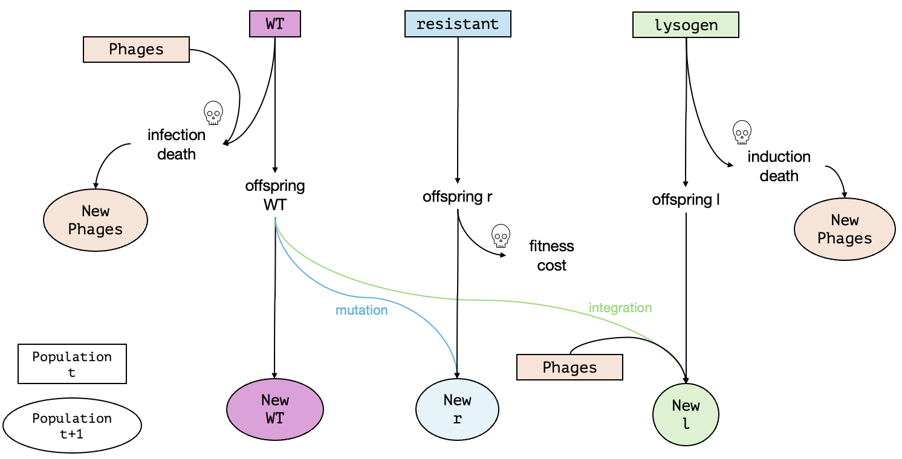

---

title: "Resistance vs. lysogeny: bacterial defense against temperate phages under phage therapy"
author: "Aylin & Marika"
date: "2026-10-15"
output:
  html_document:
    df_print: paged
---
## Abstract
When bacteria face lethal phage pressure, two strategies can rescue a population: resistance, which is slow, costly and permanent, and lysogeny, which is immediate but can be lost when the dormant phage is induced. Which strategy succeeds, and when? Using a stochastic simulation model that includes phage dynamics, we varied the cost of resistance and the induction probability and recorded how often each simulation ended in extinction, wild-type persistence, resistant or lysogenic dominance, or temporary coexistence. 

## Simulating evolutionary rescue under phage therapy

In this notebook, we are implementing simulations of evolutionary rescue in a bacterial population under phage pressure. The model is based on a single-mutation, discrete-time framework (Bank 2026, Orr 2008) extended by a phage population and a second rescue strategy. This model can be thought of as a simulation of phage therapy. Phage therapy has recently gained renewed interest as an alternative therapy to antibiotics, which is limited by the spread of antibiotic resistances. A major limitation of phage therapy is the adaptation of the pathogenic bacteria to the phages. Adaptation can be very fast and with varied strategies (Karamlou 2025). For this model, phage therapy is understood as a sudden addition of phages to a wild-type bacteria population. As simulated here, two adaptation strategies with different costs can potentially rescue the bacterial population, i.e., render the phage therapy unsuccessful. We want to explore under which conditions the bacterial population is rescued and if so, which strategy is more successful.

### Model overview: strategies and outcomes

The model is as follows: a haploid bacterial population starts with a given number of wild-type (wt) bacteria and a fixed growth rate together with a population of free phages. Because of the phages, the wild-type is unfit: in each generation wt bacteria are killed by phage infection and the more phages there are, the higher the death rate of the wild-type.
The following are the two possible survival strategies that the bacteria population have:

1. Resistance (slow but safe): wt offspring have a resistance mutation at a low rate (`mut_rate`). Resistant bacteria are immune to the phages and are not killed by infection. Resistance is permanent, but it comes with a fitness cost (`cost_r`) that reduces their offspring number. This strategy is phage-independent. 

2. Lysogen (fast but risky): wt bacteria can enter a lysogenic relationship with the phage (`lysogen_prob`), which becomes more likely the more phages are present. Lysogenic bacteria carry a dormant phage and therefore cannot die from infection. However, they can later be killed by induction of the dormant phage (`induction_prob`), which releases new phages into the environment. This strategy is phage-dependent.

Figure 1 shows a schematic of one generation. Not depicted are the rates and probabilities leading to each new population (i.e., `growth_rate`, `mut_rate`, `cost_r`, `lysogen_prob`, `induction_prob`, `infection_prob`, `P_decline`, `P_prod`). 


*Figure 1: Life cycle of one generation in the model (from generation t to generation t+1)*

All bacterial types grow with a shared carrying capacity (`K`) and the phage population is updated each generation from phage decline (`P_decline`) and from phage production at infection and induction events (`P_prod`). Resistant and lysogenic bacteria start at a population number of 0, so they have to arise from wt bacteria through mutations or integration (i.e., becoming a lysogen) and then spread before the total bacterial population goes extinct. Rescue means that the bacterial population (be it wt, resistant or lysogen) recovers and persists. 

The following are the three possible outcomes of our model:
1. Extinction
2. Only lysogen persists
3. Only resistance persists

## List of variables and parameters

| Name | Type | Description | Allowed range | Value |
|:-----|:-----|:------------|:--------------|:------|
| $N_{wt}$ | State variable | Current size of the wild-type bacteria population | integer ≥ 0 | changes over time |
| $N_r$ | State variable | Current size of the resistant bacteria population | integer ≥ 0 | changes over time |
| $N_l$ | State variable | Current size of the lysogenic bacteria population | integer ≥ 0 | changes over time |
| $N_P$ | State variable | Current size of the phage population | ≥ 0 | changes over time |
| `N_init_wt` | Initial condition | Initial size of the wild-type population | positive integer | 100 |
| `N_init_r` | Initial condition | Initial size of the resistant mutant population | integer ≥ 0 | 0 |
| `N_init_l` | Initial condition | Initial size of the lysogenic population | integer ≥ 0 | 0 |
| `N_init_P` | Initial condition | Initial size of the phage population | positive integer | 1 |
| `growth_rate` | Model parameter | Average number of offspring per bacterium (wt, r and l) per generation | ≥ 0 | 1.5 |
| `lysogen_prob` | Model parameter | Probability that a wt bacterium becomes lysogenic | 0 to 1 | 0.002 |
| `mut_rate` | Model parameter | Probability that an offspring of a wt bacterium mutates to resistant | 0 to 1 | 0.002 |
| `infection_prob` | Model parameter | Probability that a wt bacterium is infected by a phage per generation | 0 to 1 | 0.01 |
| `K` | Model parameter | Carrying capacity of the total bacteria population (wt + r + l) | positive integer | 2000 |
| `P_decline` | Model parameter | Fraction of phages decaying every generation (entered as a negative number) | ≤ 0 | -0.5 |
| `P_prod` | Model parameter | Number of new phages produced per infection or induction | ≥ 0 | 1.5 |
| `t_max` | Simulation setting | Number of generations after which the simulation stops (not a model parameter). The simulation also stops automatically if the bacterial population goes extinct | integer > 0 | 2000 |
| `induction_prob` | Varied parameter | Probability (per generation) that a lysogenic bacterium is killed by its own dormant phage | 0 to 1 | varied in the analysis |
| `cost_r` | Varied parameter | Fraction of offspring that resistant bacteria lose compared to wt (fitness cost of resistance) | 0 to 1 | varied in the analysis |

## R setup
Run this chunk to ensure you have all needed packages. Enter your local path name to the GitHub repository to access the simulation data. 

```{r setup, echo = F}
library(ggplot2)
library(tidyr)
library(dplyr)
library(tibble)

# change this to where you have saved the repository
your_pathname = "/Users/macbookair/Library/CloudStorage/OneDrive-Personal/THEE prakti/THEE Coevolution"
#your_pathname = "/Users/aylin/Documents/GitHub/THEE-Coevolution-HGT"

```


## Simulate one generation of population size change
We want to follow the numbers of wild-type, resistant and lysogenic bacteria over time, as well as the phage population. As a first step, we simulate a single generation. At generation $t$, the population consists of $N_{wt}$ wild-type bacteria, $N_r$ resistant bacteria, $N_l$ lysogens and $N_p$ phages. One generation consists of three steps:

1. **Expected offspring.** Each bacterial type has its own net growth rate, which is the intrinsic growth rate minus a type-specific loss. For wild-type bacteria the loss is the infection probability multiplied by the number of phages, so the more phages there are, the higher the death rate. For resistant bacteria the loss is the cost of resistance (`cost_r`), and for lysogens it is the induction probability (`induction_prob`). Crowding, set by the carrying capacity $K$, reduces the growth of all three types by the same amount. The number of offspring of each type is then drawn from a Poisson distribution around its expected value.

2. **Mutation and lysogen.** The wild-type offspring are divided into three groups with a multinomial draw: they become resistant (probability `mut_rate`), become lysogenic (probability `lysogen_prob` multiplied by $N_p$, since more phages make it more likely that a wild-type bacterium becomes lysogen), or remain wild type (the remaining probability).

3. **Phage dynamics.** The phage population declines by a fixed fraction (`P_decline`) and gains `P_prod` new phages for each infection of a wild-type bacterium and each induction of a lysogen.

The result of these steps gives the sizes of all bacterial populations and of the phage population at generation $t+1$.


```{r One generation}
simulate_one_gen <- function(N_wt, N_r, N_l, N_p, infection_prob, induction_prob, lysogen_prob, mut_rate, cost_r, growth_rate, K, P_decline, P_prod) {
   
  N_tot <- N_wt + N_r + N_l
  
  # intrinsic growth without losses
  r0 <- growth_rate - 1
  
  # growth rate of each type minus its specific loss 
  rho_wt <- r0 - infection_prob * N_p # includes phage population effect
  rho_r <- r0 - cost_r
  rho_l <- r0 - induction_prob
  
  # logistic growth: crowding reduces all types by the same amount --> note that deleterious effect is less strong on wt at lower density --> could exist longer at lower K
  mean_wt <- N_wt * max(0, 1 + rho_wt - r0 * N_tot / K)
  mean_r <- N_r * max(0, 1 + rho_r - r0 * N_tot / K)
  mean_l <- N_l * max(0, 1 + rho_l - r0 * N_tot / K)
  
  # 1. expected offspring (Poisson)
  offsp_wt <- rpois(1, mean_wt)
  offsp_r  <- rpois(1, mean_r)
  offsp_l  <- rpois(1, mean_l)
  
  # 2. wt bacteria (offspring) either get infected (& die) or do lysogen or stay (multinomial) 
  prob_r = mut_rate
  prob_l = min(lysogen_prob * N_p, 1 - prob_r) # includes phage population effect
  prob_wt <- max(0,1 - prob_r - prob_l)
  
  outcome <- rmultinom(1,offsp_wt,c(prob_r, prob_l, prob_wt))
  
  n_resistant <- outcome[1]
  n_lysogenic <- outcome[2]
  n_wt <- outcome[3]
  
  #new population sizes of wild type, resistant and lysogens
  N_wt_new <- n_wt
  N_r_new  <- offsp_r + n_resistant
  N_l_new  <- offsp_l + n_lysogenic
  
  # 3. phage population dynamics
  infections = min(N_wt, infection_prob * N_p * N_wt)
  inductions = induction_prob * N_l
  P_new = N_p * (1 + P_decline) + P_prod * (infections + inductions)

  return(c(N_wt_new, N_r_new, N_l_new, P_new))
}


# Test the function
# N_wt <- 1000
# N_r <- 0
# N_l <- 0
# N_p <- 5
# infection_prob <- 0.01
# induction_prob <- 0.55
# lysogen_prob <-0.002
# cost_r <- 0.55
# growth_rate <- 1.5
# mut_rate <- 0.002
# K <- 2000
# P_decline <- -0.5
# P_prod <- 1.5
# 
# print(simulate_one_gen(N_wt, N_r, N_l, N_p, infection_prob, induction_prob, lysogen_prob, mut_rate, cost_r, growth_rate, K, P_decline, P_prod))
``` 

## Simulate a population trajectory
We can now track the dynamics of the population from one generation to the next, but this is not enough. We want to follow the bacteria and phages from time 0 until the bacteria population either goes extinct or has been rescued by resistant or lysogenic bacteria. The following function repeats the one generation step up to `t_max` times and stores the sizes of the wild-type, resistant and lysogenic bacteria populations and of the phages in every generation. The simulation stops early if all bacteria (wt,r,l) have died.

```{r Population trajectory}
simulate_pop <- function(N_init_wt, N_init_r, N_init_l, N_init_p, infection_prob, induction_prob, lysogen_prob, mut_rate, cost_r, growth_rate, t_max, K, P_decline, P_prod) {
 
  
  # Create the vector in which to save the results
  pop_vector <- c(N_init_wt, N_init_r, N_init_l, N_init_p)
  # initiate the variables
  pop_new <- c(N_init_wt, N_init_r, N_init_l, N_init_p) 

  # run the simulation until generation t_max
  for (i in 1:t_max) {
    # redefine the current population one generation later
    pop_new <- simulate_one_gen(pop_new[1],pop_new[2], pop_new[3], pop_new[4], infection_prob, induction_prob, lysogen_prob, mut_rate, cost_r, growth_rate, K, P_decline, P_prod)
    # add the new population sizes to the output vector
    pop_vector <- rbind(pop_vector,pop_new)
    # condition to stop the simulation before t_max: the bacteria population goes extinct
    if (pop_new[1]+pop_new[2]+pop_new[3]==0) break
  }
  
  # define the row and column names of the output vector
  rownames(pop_vector) <- (0:t_max)[1:length(pop_vector[,1])] # note that the vector has to be cut if the simulation stopped early
  colnames(pop_vector) <- c("wt","r", "l", "p")
  # return the result
  return(pop_vector)	
}
```


## Results: Effects of varying induction_prob and cost_r on outcomes

### Combined effect of induction_prob and cost_r
Here we vary induction probability (~lysogen death rate, `induction_prob`) and the cost of resistance (~ resistant death rate, `cost_r`) at the same time, in a full grid of all combinations. The model parameters are set as defined in the model overview. `cost_r`and `induction_prob` range from 0.05 to 0.95 in steps of 0.3 For each combination, the simulation is repeated many times (`no_replicates`) and the population sizes at the final generation are recorded. Each replicate is then assigned one of five outcomes:

1. Extinction: the total bacterial population (wt + r + l) goes extinct
2. Resistance: wt and l go extinct, r remains
3. Lysogen: wt and r go extinct, l remains
4. Temporary coexistence
5. Wildtype: wt never declines

Coexistence is a category in our analysis when neither l or r have gone extinct by the end of the simulation (after `t_max`generations). Running these cases with longer `t_max`showed that there is in fact no equilibrium between r and l but one of the two was declining and had not yet reached a population size of 0 by the end of the simulation. This case is termed "temporary coexistence". The survival of the wild-type population is not possible with the set parameters. It is however included in the code for simulations with parameters where the wild-type population could subsist.

The table is saved as a csv file so that the heat maps below can be recreated without re-running the (slow) simulations.

```{r cost_r and induction_prob, echo = F}
# set some parameters to fixed values
# set t_max to a value to be used throughout
max_gen <- 2000

N_init_wt <- 100
N_init_r <- 0
N_init_l <- 0
N_init_p <- 1
infection_prob <- 0.01
lysogen_prob <- 0.002
growth_rate <- 1.7
mut_rate <- 0.0005 
K <- 2000
P_decline <- -0.5
P_prod <- 1.5

# determine how often to run the simulation for each set of parameters
no_replicates <- 100

# set parameters to vary
induction_prob = seq(0.05, 0.95, by = 0.15) # original: by = 0.3
cost_r = seq(0.05, 0.95, by = 0.15) # original: by = 0.3

# initialize data table - where to collect the results
 data_table <- c()

 # set seed for reproducibility
 set.seed(10)

# run the simulation across  both parameters: induction_prob and cost_r
  # loop over selection coefficients
  for(ival in induction_prob){
    for(cval in cost_r){
    
    # different way of running many simulations: make replicates using "repeat" function with a counter i
    # reset counter
    i<-1
    repeat {
      # increase counter by one
      i<-i+1
      # set seed inside loop to recreate single trajectories. for debugging/checking only
      #set.seed(i) 
      seed = i
      # run the simulation once with changing parameter
      one_run <- simulate_pop(N_init_wt, N_init_r, N_init_l, N_init_p, infection_prob, ival, lysogen_prob, mut_rate, cval, growth_rate, max_gen, K, P_decline, P_prod)
      
      # Record population sizes at the final simulated generation
      final_sizes <- as.numeric(tail(one_run, 1))
      
      # add current result of current iteration to datatable
      data_table <- rbind(data_table,c(ival, cval, final_sizes[1],final_sizes[2],final_sizes[3],final_sizes[4], seed )) # note that we add the varying parameters to the table too

      # stop the repeated computation after no_replicates times
      if(i>no_replicates) break
    }
}}
# define column names of data table
colnames(data_table) <- c("induction_prob", "cost_r", "wt", "r", "l", "p", "seed")
# show the first lines of the output
print(head(data_table))


## determine outcomes
# convert to dataframe
outcomes = as.data.frame(data_table)
outcomes$outcome <- NA_character_

for (i in seq_len(nrow(outcomes))) {
  wt <- outcomes[i, "wt"]
  r  <- outcomes[i, "r"]
  l  <- outcomes[i, "l"]
  seed = outcomes [i, "seed"]

  if (wt == 0 & r == 0 & l == 0) {
    outcomes$outcome[i] <- "extinction"
  } else if (wt > 0 & r == 0 & l == 0) {
    outcomes$outcome[i] <- "wt wins"
  } else if (r > 0 & wt == 0 & l == 0) {
    outcomes$outcome[i] <- "r wins"
  } else if (l > 0 & wt == 0 & r == 0) {
    outcomes$outcome[i] <- "l wins"
  } else {
    outcomes$outcome[i] <- "temporary coexistence"
  }
}

print(head(outcomes))
print(tail(outcomes))

# save data with today's date. any data generated on the same date will overwrite this file
write.csv(outcomes, paste(your_pathname, "/data/combined_r_l_data", Sys.Date(), ".csv", sep = ""))
```

### Heat maps of the combined analysis
The saved data from the grid simulation above is read in and for each combination of induction_prob (y axis) and cost_r (x axis), the proportion of replicates with a given outcome is calculated. This is shown as four heat maps (the number in each tile is the proportion of replicates, from 0 to 1). 

```{r heat maps prep, echo = F}
# get data
# if you want to access data from an earlier simulation, set the date to the day it was created (format YYYY-MM-DD), otherwise use Sys.date()
date = "2026-11-04"
outcomes = read.csv(paste(your_pathname, "/data/combined_r_l_data", date, ".csv", sep = ""))

## plot outcomes

# treat parameters as a categorical axis
outcomes$induction_prob <- factor(outcomes$induction_prob)
outcomes$cost_r = factor(outcomes$cost_r)

# fix the order of the five outcomes so colours are consistent
outcomes$outcome <- factor(outcomes$outcome,
  levels = c("extinction", "wt wins", "r wins", "l wins", "temporary coexistence"))
```

```{r heat map extinction, echo = F}
## heat map for extinction (Claude)

# extinction probability per parameter combination
ext <- outcomes %>%
  group_by(induction_prob, cost_r) %>%
  summarise(p_ext = mean(outcome == "extinction"),
            n_runs = n(),
            .groups = "drop")

ggplot(ext, aes(x = cost_r, y = induction_prob, fill = p_ext)) +
  geom_tile(colour = "white", linewidth = 0.8) +
  geom_text(aes(label = sprintf("%.2f", p_ext)), size = 4) +
  scale_fill_gradient(low = "white", high = "#D55E00",
                      limits = c(0, 1), name = "P(extinction)") +
  labs(x = "Cost of resistance (cost_r)",
       y = "Induction probability (induction_prob)") +
  coord_equal() +
  theme_minimal() +
  ggtitle("Probability of extinction")
```
*Figure 2: Heat map of probability of extinction of the total population*

```{r heat map survival/rescue, echo = F}
## heat map for survival/rescue of total population
# survival probability per parameter combination
surv = outcomes %>%
  group_by(induction_prob, cost_r) %>%
  summarise(p_surv = mean(outcome != "extinction"),
            n_runs = n(),
            .groups = "drop")

ggplot(surv, aes(x = cost_r, y = induction_prob, fill = p_surv)) +
  geom_tile(colour = "white", linewidth = 0.8) +
  geom_text(aes(label = sprintf("%.2f", p_surv)), size = 4) +
  scale_fill_gradient(low = "white", high = "purple",
                      limits = c(0, 1), name = "P(rescue)") +
  labs(x = "Cost of resistance (cost_r)",
       y = "Induction probability (induction_prob)") +
  coord_equal() +
  theme_minimal() +
  ggtitle("Probability of rescue of total population")
```
*Figure 3: Heat map of probability of survival of the total population (= 1 - extinction; this counts every outcome except extinction, including wt wins and temporary coexistence)*

```{r heat map lysogen, echo = F}
## heat map for lysogen
# lysogen probability per parameter combination
lys <- outcomes %>%
  group_by(induction_prob, cost_r) %>%
  summarise(p_lys = mean(outcome == "l wins"),
            n_runs = n(),
            .groups = "drop")

ggplot(lys, aes(x = cost_r, y = induction_prob, fill = p_lys)) +
  geom_tile(colour = "white", linewidth = 0.8) +
  geom_text(aes(label = sprintf("%.2f", p_lys)), size = 4) +
  scale_fill_gradient(low = "white", high = "#009E73",
                      limits = c(0, 1), name = "P(lysogen)") +
  labs(x = "Cost of resistance (cost_r)",
       y = "Induction probability (induction_prob)") +
  coord_equal() +
  theme_minimal() +
  ggtitle("Probability of lysogen outcome is high until threshold of induction probability")
```
*Figure 4: Heat map of probability that only lysogens (l) remain*

```{r heat map resistance, echo = F}
## heat map for resistance
# resistance probability per parameter combination
res <- outcomes %>%
  group_by(induction_prob, cost_r) %>%
  summarise(p_res = mean(outcome == "r wins"),
            n_runs = n(),
            .groups = "drop")

ggplot(res, aes(x = cost_r, y = induction_prob, fill = p_res)) +
  geom_tile(colour = "white", linewidth = 0.8) +
  geom_text(aes(label = sprintf("%.2f", p_res)), size = 4) +
  scale_fill_gradient(low = "white", high = "#0072B2",
                      limits = c(0, 1), name = "P(resistance)") +
  labs(x = "Cost of resistance (cost_r)",
       y = "Induction probability (induction_prob)") +
  coord_equal() +
  theme_minimal() +
  ggtitle("Probability of resistance outcome is low and gradually decreasing with increasing cost r")

```
*Figure 5: Heat map of probability that only resistant bacteria (r) remain*

Looking at Fig. 4 and 5., two different behaviours of the two strategies become apparent: The lysogen outcome probability is constantly comparatively high (no less than 50% of outcomes, and up to 100% of outcomes for lower induction probabilites) and abruptly decreases to 0% above a certain threshold. The resistant outcome probability is comparatively lower (not more than 39% of outcomes) and has a gradual decrease with increasing cost of r. Combined, this results in a survivability heatmap (Figure 3) that has a somewhat gradual decrease from left to right (increasing cost of r) but quite an abrupt drop from bottom to top (increasing induction probability). This behaviour is also visible when only varying one of the variable parameters: with increasing cost of r (induction_prob constant at 0.46), the decrease of resistance outcomes is gradual from 71 to 42% before dropping to 0. When no resistance is possible, the fractions of lysogen and extinction outcomes are constant at 74-79% and 21-26%, respectively (Supplementary Figure 5). When only the induction probability is increased (cost_r = 0.1), the lysogen outcomes stay between 57 and 68% and then drop to 0 above an induction probability of 0.65. Above this, the extinction fraction is constantly at 67% (Supplementary Figure 6). 

The resistant strategy seems to be much more density-dependent: its outcome probability is not only dependent on the cost of r but also the induction probability, i.e., the fitness of l. In contrast, the lysogen strategy success is dependent on its own fitness: above a certain threshold, it performs well. Under this fitness threshold, the lysogen outcome probability drops to 0. 
This might be due to the differences in phage dependency: the resistant strategy is phage-independent and arises through mutation (at a set mutation rate). The number of ofspring is stochastic depending on the muation rate. The lysogen strategy depends on a probability of integration which is multiplied by the phage population, giving the lysogen population a "boost". Up to a certain threshold of induction probability, the lysogen have a positive feedback loop: with every induction (i.e., death of a lysogen), more phages are produced which in turn increase the integration and hence creation of new lysogens. This removes the stochastic aspect and makes the growth of the lysogen population deterministic until a threshold where the positive feedback loop is not sustained and the integration probability/fitness cost becomes too high.

## Limitations
The model is a very simplistic depiction of bacteria-phage interactions. 
- low phage production
- only two strategies
- "rigid" strategies and not an arms race (coevolution) between bacteria and phages
- unrealistic to have temperate phages for phage therapy


## Conclusions/Limitations/Thoughts
- start with 1 phage. not so realistic, also if want to test effect of phage therapy varying this could be a thing --> as outlook!
- also phage production is very low (but strongly boosts lysogen production so maybe good to keep low)
- outcome is dependent on K: if K is lower, l is a more likely outcome. would be interesting to analyze this but no time. --> is it tho? barplots with lower K don't seem to have more but rather less l
- due to interaction with phage population, the lysogen generation becomes deterministic instead of stochastic (like the resistant generation). it is boosted by phages. above a threshold of around 0.5 induction probabilty, the lysogen population abruptly looses its advantage as the fitness cost is too high, the population cannot be sustained.
- mention that outcomes "wt persists" and "coexistence" are not possible for our model.
- Alexander et al. (2014) highlight the importance of applying evolutionary rescue theories used in conservation in medicine as well, as the dynamics are very similar. 
- value/importance of report/model
- k probably causes a lot of the (dis)advantage of the two strategies
- r is strongly dependent on density dependence (gradual increase of outcomes with increasing induction_prob, i.e., less l), while l is more constantly high but depends a lot on a high fitness , i.e., low enough induction_prob (drop from 50 to 0% outcomes above threshold of around 0.65)

## References
Alexander HK et al. (2014) Evolutionary rescue: linking theory for conservation and medicine. *Evolutionary Applications* 7: 1161-79. DOI: https://doi.org/10.1111/eva.12221

Bank C (2026) Course material: basic evolutionary rescue notebook

Karamlou S et al. (2025) Bacterial resistance to phage therapy: Mechanisms and strategies to overcome it. *Current Molecular Pharmacology* 18: 108-122. DOI: https://doi.org/10.1016/j.cmp.2025.11.003

Orr HA, Unckless RL (2008) Population Extinction and the Genetics of Adaptation. *The American Naturalist* 172(2). DOI:https://doi.org/10.1086/589460

## Author contributions
- 

## AI use declaration
Claude and ChatGPT were used on the R code for
- debugging
- implementing concepts in the base code (e.g., carrying capacity)
- generating plots
- RMarkdown layout
Furthermore, Claude was used to determine useful parameter ranges.

For debugging and implementing concepts, suggestions from Claude and ChatGPT were not copied as a whole but selective changes were manually made in the code to ensure no unknown changes happened. 
For visuals (plots and layout), whole code blocks were copied. The outputs were checked visually (i.e., whether they generated what we imagined). 

## Supplementary figures
### Population trajectories with different strategies
Here we plot population trajectories with 1) both strategies, 2) no strategies, 3) only lysogeny (no resistance) and 4) only resistance (no lysogeny) for illustration purposes.

```{r all strategies, echo = F}
# simulation and plotting of complete model
# set t_max to a value to be used throughout

max_gen <- 500

N_init_wt <- 100
N_init_r <- 0
N_init_l <- 0
N_init_p <- 1
infection_prob <- 0.01
lysogen_prob <- 0.002
growth_rate <- 1.5
mut_rate <- 0.002 
K <- 2000
P_decline <- -0.5
P_prod <- 1.5

# set parameters to vary
induction_prob = 0.48
cost_r = 0.35


set.seed(10)
# create your simulation data
output <- simulate_pop(N_init_wt, N_init_r, N_init_l, N_init_p, infection_prob, induction_prob, lysogen_prob, mut_rate, cost_r, growth_rate, max_gen, K, P_decline, P_prod)
# show the last few lines of the data table
print(tail(output))


# plot the output - note that the plot range and the x axis have to be adjusted based on the length of the table
# determine x axis range 
x_range <- 0:(length(output[,1])-1)

# Convert simulation output into a data frame
output_df <- as.data.frame(output) %>%
  mutate(Generation = as.numeric(rownames(output))) %>%
  mutate(Total = wt + r + l) 

# Reshape data for ggplot
plot_data <- output_df %>%
  pivot_longer(
    cols = c(Total, wt, r, l, p),
    names_to = "Population",
    values_to = "Size"
  ) %>%
  mutate(
    Population = factor(
      Population,
      levels = c("Total", "wt", "r", "l", "p"),
      labels = c(
        "Total population",
        "Wild type",
        "Resistant",
        "Lysogenic",
        "Phages"
      )
    )
  )


# Plot population trajectories
ggplot(
  plot_data,
  aes(
    x = Generation,
    y = Size,
    colour = Population,
    linetype = Population,
    alpha = Population
  )
) +
  geom_line(linewidth = 0.4) +
  scale_colour_manual(
    values = c(
      "Total population" = "black",
      "Wild type" = "#E69F00",
      "Resistant" = "#0072B2",
      "Lysogenic" = "#009E73",
      "Phages" = "#CC79A7"
    )
  ) +
  scale_linetype_manual(
    values = c(
      "Total population" = "dotted",
      "Wild type" = "solid",
      "Resistant" = "solid",
      "Lysogenic" = "solid",
      "Phages" = "solid"
    )
  ) +
  scale_alpha_manual(
    values = c(
      "Total population" = 0.7,
      "Wild type" = 1,
      "Resistant" = 1,
      "Lysogenic" = 1,
      "Phages" = 1
    )
  ) +
  labs(
    x = "Generation",
    y = "Population size",
    colour = NULL,
    linetype = NULL,
    alpha = NULL
  ) +
  ggtitle("Evolutionary rescue with resistant and lysogenic bacteria") +
  theme_classic() +
  theme(
    legend.position = "right",
    legend.justification = "center",
    legend.background = element_blank()
  )

```
*Supplementary Figure 1: Population trajectories with resistant and lysogen strategies with set model parameters (see model overview), `induction_prob` = 0.48 and `cost_r`= 0.35. `K` = 500 for better resolution.*

```{r No survival strategy, echo = F}
# simulation and plotting of model without resistance or lysogens

max_gen <- 2000
N_init_wt <- 100
N_init_r <- 0
N_init_l <- 0
N_init_p <- 1
infection_prob <- 0.01
lysogen_prob <- 0
growth_rate <- 1.5
mut_rate <- 0
K <- 2000
P_decline <- -0.5
P_prod <- 1.5

# set parameters to vary
induction_prob = 0.35
cost_r = 0


set.seed(10)
# create your simulation data
output <- simulate_pop(N_init_wt, N_init_r, N_init_l, N_init_p, infection_prob, induction_prob, lysogen_prob, mut_rate, cost_r, growth_rate, max_gen, K, P_decline, P_prod)
# show the last few lines of the data table
print(tail(output))


# plot the output - note that the plot range and the x axis have to be adjusted based on the length of the table
# determine x axis range 
x_range <- 0:(length(output[,1])-1)


# Convert simulation output into a data frame
output_df <- as.data.frame(output) %>%
  mutate(Generation = as.numeric(rownames(output))) %>%
  mutate(Total = wt + r + l) 

# Reshape data for ggplot
plot_data <- output_df %>%
  pivot_longer(
    cols = c(Total, wt, r, l, p),
    names_to = "Population",
    values_to = "Size"
  ) %>%
  mutate(
    Population = factor(
      Population,
      levels = c("Total", "wt", "r", "l", "p"),
      labels = c(
        "Total population",
        "Wild type",
        "Resistant",
        "Lysogenic",
        "Phages"
      )
    )
  )


# Plot population trajectories
ggplot(
  plot_data,
  aes(
    x = Generation,
    y = Size,
    colour = Population,
    linetype = Population,
    alpha = Population
  )
) +
  geom_line(linewidth = 0.4) +
  scale_colour_manual(
    values = c(
      "Total population" = "black",
      "Wild type" = "#E69F00",
      "Resistant" = "#0072B2",
      "Lysogenic" = "#009E73",
      "Phages" = "#CC79A7"
    )
  ) +
  scale_linetype_manual(
    values = c(
      "Total population" = "dotted",
      "Wild type" = "solid",
      "Resistant" = "solid",
      "Lysogenic" = "solid",
      "Phages" = "solid"
    )
  ) +
  scale_alpha_manual(
    values = c(
      "Total population" = 0.7,
      "Wild type" = 1,
      "Resistant" = 1,
      "Lysogenic" = 1,
      "Phages" = 1
    )
  ) +
  labs(
    x = "Generation",
    y = "Population size",
    colour = NULL,
    linetype = NULL,
    alpha = NULL
  ) +
  ggtitle("Evolutionary rescue with no survival strategy") +
  theme_classic() +
  theme(
    legend.position = "right",
    legend.justification = "center",
    legend.background = element_blank()
  )

``` 
*Supplementary Figure 2: Population trajectories with no survival strategies with set model parameters (see model overview) and `lysogen_prob` = 0 and `mut_rate = 0`*


```{r No resistance, echo =F}
# simulation and plotting with only one survival strategy: lysogeny (no resistance)

max_gen <- 2000
N_init_wt <- 100
N_init_r <- 0
N_init_l <- 0
N_init_p <- 1
infection_prob <- 0.01
lysogen_prob <- 0.002
growth_rate <- 1.5
mut_rate <- 0
K <- 2000
P_decline <- -0.5
P_prod <- 1.5

# set parameters to vary
induction_prob = 0.35
cost_r = 0


set.seed(10)
# create your simulation data
output <- simulate_pop(N_init_wt, N_init_r, N_init_l, N_init_p, infection_prob, induction_prob, lysogen_prob, mut_rate, cost_r, growth_rate, max_gen, K, P_decline, P_prod)
# show the last few lines of the data table
print(tail(output))


# plot the output - note that the plot range and the x axis have to be adjusted based on the length of the table
# determine x axis range 
x_range <- 0:(length(output[,1])-1)

# Convert simulation output into a data frame
output_df <- as.data.frame(output) %>%
  mutate(Generation = as.numeric(rownames(output))) %>%
  mutate(Total = wt + r + l) 

# Reshape data for ggplot
plot_data <- output_df %>%
  pivot_longer(
    cols = c(Total, wt, r, l, p),
    names_to = "Population",
    values_to = "Size"
  ) %>%
  mutate(
    Population = factor(
      Population,
      levels = c("Total", "wt", "r", "l", "p"),
      labels = c(
        "Total population",
        "Wild type",
        "Resistant",
        "Lysogenic",
        "Phages"
      )
    )
  )


# Plot population trajectories
ggplot(
  plot_data,
  aes(
    x = Generation,
    y = Size,
    colour = Population,
    linetype = Population,
    alpha = Population
  )
) +
 geom_line(linewidth = 0.4) +
  scale_colour_manual(
    values = c(
      "Total population" = "black",
      "Wild type" = "#E69F00",
      "Resistant" = "#0072B2",
      "Lysogenic" = "#009E73",
      "Phages" = "#CC79A7"
    )
  ) +
  scale_linetype_manual(
    values = c(
      "Total population" = "dotted",
      "Wild type" = "solid",
      "Resistant" = "solid",
      "Lysogenic" = "solid",
      "Phages" = "solid"
    )
  ) +
  scale_alpha_manual(
    values = c(
      "Total population" = 0.7,
      "Wild type" = 1,
      "Resistant" = 1,
      "Lysogenic" = 1,
      "Phages" = 1
    )
  ) +
  labs(
    x = "Generation",
    y = "Population size",
    colour = NULL,
    linetype = NULL,
    alpha = NULL
  ) +
  ggtitle("Evolutionary rescue with only lysogenic bacteria") +
  theme_classic() +
  theme(
    legend.position = "right",
    legend.justification = "center",
    legend.background = element_blank()
  )
```
*Supplementary Figure 3: Population trajectories with only lysogenic strategy with set model parameters (see model overview), `lysogen_prob` = 0.002, `mut_rate` = 0 and `induction_prob` = 0.35*


```{r No lysogeny, echo =F}
# simulation and plotting with only one survival strategy: resistance (no lysogeny)


max_gen <- 2000

N_init_wt <- 100
N_init_r <- 0
N_init_l <- 0
N_init_p <- 1
infection_prob <- 0.01
lysogen_prob <- 0.002
growth_rate <- 1.5
mut_rate <- 0.002 
K <- 2000
P_decline <- -0.5
P_prod <- 1.5

# set parameters to vary
induction_prob = 0.35
cost_r = 0.35

set.seed(10)
# create your simulation data
output <- simulate_pop(N_init_wt, N_init_r, N_init_l, N_init_p, infection_prob, induction_prob, lysogen_prob, mut_rate, cost_r, growth_rate, max_gen, K, P_decline, P_prod)
# show the last few lines of the data table
print(tail(output))


# plot the output - note that the plot range and the x axis have to be adjusted based on the length of the table
# determine x axis range 
x_range <- 0:(length(output[,1])-1)


# Convert simulation output into a data frame
output_df <- as.data.frame(output) %>%
  mutate(Generation = as.numeric(rownames(output))) %>%
  mutate(Total = wt + r + l) 

# Reshape data for ggplot
plot_data <- output_df %>%
  pivot_longer(
    cols = c(Total, wt, r, l, p),
    names_to = "Population",
    values_to = "Size"
  ) %>%
  mutate(
    Population = factor(
      Population,
      levels = c("Total", "wt", "r", "l", "p"),
      labels = c(
        "Total population",
        "Wild type",
        "Resistant",
        "Lysogenic",
        "Phages"
      )
    )
  )


# Plot population trajectories
ggplot(
  plot_data,
  aes(
    x = Generation,
    y = Size,
    colour = Population,
    linetype = Population,
    alpha = Population
  )
) +
  geom_line(linewidth = 0.4) +
  scale_colour_manual(
    values = c(
      "Total population" = "black",
      "Wild type" = "#E69F00",
      "Resistant" = "#0072B2",
      "Lysogenic" = "#009E73",
      "Phages" = "#CC79A7"
    )
  ) +
  scale_linetype_manual(
    values = c(
      "Total population" = "dotted",
      "Wild type" = "solid",
      "Resistant" = "solid",
      "Lysogenic" = "solid",
      "Phages" = "solid"
    )
  ) +
  scale_alpha_manual(
    values = c(
      "Total population" = 0.7,
      "Wild type" = 1,
      "Resistant" = 1,
      "Lysogenic" = 1,
      "Phages" = 1
    )
  ) +
  labs(
    x = "Generation",
    y = "Population size",
    colour = NULL,
    linetype = NULL,
    alpha = NULL
  ) +
  ggtitle("Evolutionary rescue with only resistant bacteria") +
  theme_classic() +
  theme(
    legend.position = "right",
    legend.justification = "center",
    legend.background = element_blank()
  )

```
*Supplementary Figure 4: Population trajectories with only resistant strategy with set model parameters (see model overview), `lysogen_prob` = 0, `mut_rate` = 0.002 and `cost_r` = 0.35*


### Analysis: Effects of induction_prob and cost_r
Here, we analyze the effects of varying induction probability (~ lysogen death rate) and the cost of r (~ resistant death rate) on three possible outcomes:

1. Extinction: the total bacterial population (wt + r + l) goes extinct
2. Resistance: wt and l go extinct, r remains
3. Lysogen: wt and r go extinct, l remains

Coexistence is a category in our analysis when neither l or r have gone extinct by the end of the simulation (after `t_max`generations). Running these cases with longer `t_max`showed that there is in fact no equilibrium between r and l but one of the two was declining and had not yet reached a population size of 0 by the end of the simulation. This case is termed "temporary coexistence". 

The proportion of outcomes is plotted as barplots (for varying induction probabilty and cost of r, respectively).

```{r cost_r iterations, echo = F}
# set some parameters to fixed values
# set t_max to a value to be used throughout
max_gen <- 2000

N_init_wt <- 100
N_init_r <- 0
N_init_l <- 0
N_init_p <- 1
infection_prob <- 0.01
lysogen_prob <- 0.002
growth_rate <- 1.5
mut_rate <- 0.002
K <- 2000
P_decline <- -0.5
P_prod <- 1.5

# determine how often to run the simulation for each set of parameters
no_replicates <- 100

# set parameters to vary
induction_prob = 0.46
cost_r = seq(0.05, 0.95, by = 0.15)

# initialize data table - where to collect the results
 data_table <- c()

 # set seed for reproducibility
 set.seed(10)

# run the simulation across  chosen parameter: cost_r
  # loop over selection coefficients
  for(cval in cost_r){
    # different way of running many simulations: make replicates using "repeat" function with a counter i
    # reset counter
    i<-1
    repeat {
      # increase counter by one
      i<-i+1
      # set seed inside loop to recreate single trajectories. for debugging/checking only
      #set.seed(i) 
      seed = i
      # run the simulation once with changing parameter
      one_run <- simulate_pop(N_init_wt, N_init_r, N_init_l, N_init_p, infection_prob, induction_prob, lysogen_prob, mut_rate, cval, growth_rate, max_gen, K, P_decline, P_prod)
      
      # Record population sizes at the final simulated generation
      final_sizes <- as.numeric(tail(one_run, 1))
      
      # add current result of current iteration to datatable
      data_table <- rbind(data_table,c(cval,final_sizes[1],final_sizes[2],final_sizes[3],final_sizes[4], seed )) # note that we add the varying parameters to the table too

      # stop the repeated computation after no_replicates times
      if(i>no_replicates) break
    }
}
# define column names of data table
colnames(data_table) <- c("cost_r", "wt", "r", "l", "p", "seed")
# show the first lines of the output
print(head(data_table))


## determine outcomes
# convert to dataframe
outcomes = as.data.frame(data_table)
outcomes$outcome <- NA_character_

for (i in seq_len(nrow(outcomes))) {
  wt <- outcomes[i, "wt"]
  r  <- outcomes[i, "r"]
  l  <- outcomes[i, "l"]
  seed = outcomes [i, "seed"]

  if (wt == 0 & r == 0 & l == 0) {
    outcomes$outcome[i] <- "extinction"
  } else if (wt > 0 & r == 0 & l == 0) {
    outcomes$outcome[i] <- "wt wins"
  } else if (r > 0 & wt == 0 & l == 0) {
    outcomes$outcome[i] <- "r wins"
  } else if (l > 0 & wt == 0 & r == 0) {
    outcomes$outcome[i] <- "l wins"
  } else {
    outcomes$outcome[i] <- "temporary coexistence"
  }
}

print(head(outcomes))

# save data with today's date. any data generated on the same date will overwrite this file
write.csv(outcomes, paste(your_pathname, "/data/cost_r_iterations", Sys.Date(), ".csv", sep = ""))
```


```{r cost_r iterations plots, echo = F}
## plot outcomes of cost_r iterations

# get data
# if you want to access data from an earlier simulation, set the date to the day it was created (format YYYY-MM-DD), otherwise use Sys.Date()
date = Sys.Date()
outcomes = read.csv(paste(your_pathname, "/data/cost_r_iterations", date, ".csv", sep = ""))

# treat cost_r as a categorical axis 
outcomes$cost_r <- factor(outcomes$cost_r)

# fix the order of the five outcomes so colours are consistent
outcomes$outcome <- factor(outcomes$outcome,
  levels = c("extinction", "wt wins", "r wins", "l wins", "temporary coexistence"))

# define colors
pal <- c("extinction"            = "grey50",
         "wt wins"               = "#E69F00",
         "r wins"                = "#0072B2",
         "l wins"                = "#009E73",
         "temporary coexistence" = "#F0E442")

# proportion of each outcome per cost_r
props <- outcomes %>%
  count(cost_r, outcome, .drop = FALSE) %>%
  group_by(cost_r) %>%
  mutate(prop = n / sum(n)) %>%
  ungroup() %>%
  filter(n > 0)          # no labels for outcomes that never occur

# barplot with percentage labels
props <- tidyr::complete(props, cost_r, outcome, fill = list(prop = 0))
ggplot(props, aes(x = cost_r, y = prop, fill = outcome)) +
  geom_col(position = position_fill(reverse = TRUE)) +
  geom_text(aes(label = ifelse(prop > 0, scales::percent(prop, accuracy = 1), ""),
                colour = outcome == "r wins",
                group = outcome),
            position = position_fill(vjust = 0.5, reverse = TRUE),
            size = 3.5, show.legend = FALSE) +
  scale_colour_manual(values = c("TRUE" = "white", "FALSE" = "black")) +
  scale_y_continuous(labels = scales::percent) +
  scale_fill_manual(values = pal, drop = FALSE) +
  labs(x = "Cost of resistance (cost_r)",
       y = "Proportion of replicates",
       fill = "Outcome") +
  theme_minimal() +
  ggtitle("Outcome proportions with different cost_r")
```
*Supplementary Figure 5: Barplot of outcome proportions of 100 simulation replicates with varying `cost_r`, `induction_prob`= 0.46 and set model parameters (see model overview)*

```{r induction_prob iterations, echo = F}
# set some parameters to fixed values
# set t_max to a value to be used throughout
max_gen <- 2000

N_init_wt <- 100
N_init_r <- 0
N_init_l <- 0
N_init_p <- 1
infection_prob <- 0.01
lysogen_prob <- 0.002
growth_rate <- 1.7
mut_rate <- 0.0005 
K <- 2000
P_decline <- -0.5
P_prod <- 1.5

# determine how often to run the simulation for each set of parameters
no_replicates <- 100

# set parameters to vary
induction_prob = seq(0.05, 0.95, by = 0.15)
cost_r = 0.1

# initialize data table - where to collect the results
 data_table <- c()

 # set seed for reproducibility
  set.seed(10)

# run the simulation across  chosen parameter: induction_prob
  # loop over selection coefficients
  for(ival in induction_prob){
    # different way of running many simulations: make replicates using "repeat" function with a counter i
    # reset counter
    i<-1
    repeat {
      # increase counter by one
      i<-i+1
       # set seed inside loop to recreate single trajectories. for debugging/checking only
      #set.seed(i) 
      seed = i
      # run the simulation once with changing parameter
      one_run <- simulate_pop(N_init_wt, N_init_r, N_init_l, N_init_p, infection_prob, ival, lysogen_prob, mut_rate, cost_r, growth_rate, max_gen, K, P_decline, P_prod)
      
      # Record population sizes at the final simulated generation
      final_sizes <- as.numeric(tail(one_run, 1))
      
      # add current result of current iteration to datatable
      data_table <- rbind(data_table,c(ival,final_sizes[1],final_sizes[2],final_sizes[3],final_sizes[4], seed )) # note that we add the varying parameters to the table too

      # stop the repeated computation after no_replicates times
      if(i>no_replicates) break
    }
}
# define column names of data table
colnames(data_table) <- c("induction_prob", "wt", "r", "l", "p", "seed")
# show the first lines of the output
print(head(data_table))


## determine outcomes
# convert to dataframe
outcomes = as.data.frame(data_table)
outcomes$outcome <- NA_character_

for (i in seq_len(nrow(outcomes))) {
  wt <- outcomes[i, "wt"]
  r  <- outcomes[i, "r"]
  l  <- outcomes[i, "l"]
  seed = outcomes [i, "seed"]

  if (wt == 0 & r == 0 & l == 0) {
    outcomes$outcome[i] <- "extinction"
  } else if (wt > 0 & r == 0 & l == 0) {
    outcomes$outcome[i] <- "wt wins"
  } else if (r > 0 & wt == 0 & l == 0) {
    outcomes$outcome[i] <- "r wins"
  } else if (l > 0 & wt == 0 & r == 0) {
    outcomes$outcome[i] <- "l wins"
  } else {
    outcomes$outcome[i] <- "temporary coexistence"
  }
}

print(head(outcomes))

# save data with today's date. any data generated on the same date will overwrite this file
write.csv(outcomes, paste(your_pathname, "/data/induction_prob_iterations", Sys.Date(), ".csv", sep = ""))
```


```{r induction_prob iterations plots, echo = F}
## plot outcomes of induction_prob iterations

# get data
# if you want to access data from an earlier simulation, set the date to the day it was created (format YYYY-MM-DD), otherwise use Sys.Date()
date = Sys.Date()
outcomes = read.csv(paste(your_pathname, "/data/induction_prob_iterations", date, ".csv", sep = ""))

# treat induction_prob as a categorical axis
outcomes$induction_prob <- factor(outcomes$induction_prob)

# fix the order of the five outcomes so colours are consistent
outcomes$outcome <- factor(outcomes$outcome,
  levels = c("extinction", "wt wins", "r wins", "l wins", "temporary coexistence"))

# define colors
pal <- c("extinction"            = "grey50",
         "wt wins"               = "#E69F00",
         "r wins"                = "#0072B2",
         "l wins"                = "#009E73",
         "temporary coexistence" = "#F0E442")

# proportion of each outcome per induction_prob
props <- outcomes %>%
  count(induction_prob, outcome, .drop = FALSE) %>%
  group_by(induction_prob) %>%
  mutate(prop = n / sum(n)) %>%
  ungroup() %>%
  filter(n > 0)          # no labels for outcomes that never occur

# barplot with percentage labels
props$outcome <- factor(props$outcome, levels = names(pal))
props <- tidyr::complete(props, induction_prob, outcome, fill = list(prop = 0))
ggplot(props, aes(x = induction_prob, y = prop, fill = outcome)) +
  geom_col(position = position_fill(reverse = TRUE)) +
  geom_text(aes(label = ifelse(prop > 0, scales::percent(prop, accuracy = 1), ""),
                colour = outcome == "r wins",
                group = outcome),
            position = position_fill(vjust = 0.5, reverse = TRUE),
            size = 3.5, show.legend = FALSE) +
  scale_colour_manual(values = c("TRUE" = "white", "FALSE" = "black")) +
  scale_y_continuous(labels = scales::percent) +
  scale_fill_manual(values = pal, drop = FALSE) +
  labs(x = "Induction probability (induction_prob)",
       y = "Proportion of replicates",
       fill = "Outcome") +
  theme_minimal() +
  ggtitle("Outcome proportions with different induction_prob")

```
*Supplementary Figure 6: Barplot of outcome proportions of 100 simulation replicates with varying `induction_prob`, `cost_r`= 0.1 and set model parameters (see model overview)*

### Effects of varying cost_r with no lysogeny
```{r cost_r iterations NO L, echo = F}
# set some parameters to fixed values
# set t_max to a value to be used throughout
max_gen <- 2000

N_init_wt <- 100
N_init_r <- 0
N_init_l <- 0
N_init_p <- 1
infection_prob <- 0.01
lysogen_prob <- 0
growth_rate <- 1.5
mut_rate <- 0.002
K <- 2000
P_decline <- -0.5
P_prod <- 1.5

# determine how often to run the simulation for each set of parameters
no_replicates <- 100

# set parameters to vary
induction_prob = 0.46
cost_r = seq(0.05, 0.95, by = 0.3)

# initialize data table - where to collect the results
 data_table <- c()

 # set seed for reproducibility
 set.seed(10)

# run the simulation across  chosen parameter: cost_r
  # loop over selection coefficients
  for(cval in cost_r){
    # different way of running many simulations: make replicates using "repeat" function with a counter i
    # reset counter
    i<-1
    repeat {
      # increase counter by one
      i<-i+1
      # set seed inside loop to recreate single trajectories. for debugging/checking only
      #set.seed(i) 
      seed = i
      # run the simulation once with changing parameter
      one_run <- simulate_pop(N_init_wt, N_init_r, N_init_l, N_init_p, infection_prob, induction_prob, lysogen_prob, mut_rate, cval, growth_rate, max_gen, K, P_decline, P_prod)
      
      # Record population sizes at the final simulated generation
      final_sizes <- as.numeric(tail(one_run, 1))
      
      # add current result of current iteration to datatable
      data_table <- rbind(data_table,c(cval,final_sizes[1],final_sizes[2],final_sizes[3],final_sizes[4], seed )) # note that we add the varying parameters to the table too

      # stop the repeated computation after no_replicates times
      if(i>no_replicates) break
    }
}
# define column names of data table
colnames(data_table) <- c("cost_r", "wt", "r", "l", "p", "seed")
# show the first lines of the output
print(head(data_table))


## determine outcomes
# convert to dataframe
outcomes = as.data.frame(data_table)
outcomes$outcome <- NA_character_

for (i in seq_len(nrow(outcomes))) {
  wt <- outcomes[i, "wt"]
  r  <- outcomes[i, "r"]
  l  <- outcomes[i, "l"]
  seed = outcomes [i, "seed"]

  if (wt == 0 & r == 0 & l == 0) {
    outcomes$outcome[i] <- "extinction"
  } else if (wt > 0 & r == 0 & l == 0) {
    outcomes$outcome[i] <- "wt wins"
  } else if (r > 0 & wt == 0 & l == 0) {
    outcomes$outcome[i] <- "r wins"
  } else if (l > 0 & wt == 0 & r == 0) {
    outcomes$outcome[i] <- "l wins"
  } else {
    outcomes$outcome[i] <- "temporary coexistence"
  }
}

print(head(outcomes))

# save data with today's date. any data generated on the same date will overwrite this file
write.csv(outcomes, paste(your_pathname, "/data/cost_r_iterations_NO_L", Sys.Date(), ".csv", sep = ""))
```


```{r cost_r iterations NO L plots, echo = F}
## plot outcomes of cost_r iterations (NO LYSOGENY)

# get data
# if you want to access data from an earlier simulation, set the date to the day it was created (format YYYY-MM-DD), otherwise use Sys.date()
date = "2026-11-04"
outcomes = read.csv(paste(your_pathname, "/data/cost_r_iterations_NO_L", date, ".csv", sep = ""))

# treat cost_r as a categorical axis
outcomes$cost_r <- factor(outcomes$cost_r)

# fix the order of the five outcomes so colours are consistent
outcomes$outcome <- factor(outcomes$outcome,
  levels = c("extinction", "wt wins", "r wins", "l wins", "temporary coexistence"))

 # define colors
pal <- c("extinction"            = "grey50",
         "wt wins"               = "#E69F00",
         "r wins"                = "#0072B2",
         "l wins"                = "#009E73",
         "temporary coexistence" = "#F0E442")

# proportion of each outcome per cost_r
props <- outcomes %>%
  count(cost_r, outcome, .drop = FALSE) %>%
  group_by(cost_r) %>%
  mutate(prop = n / sum(n)) %>%
  ungroup() %>%
  filter(n > 0)          # no labels for outcomes that never occur

# barplot with percentage labels
props$outcome <- factor(props$outcome, levels = names(pal))
props <- tidyr::complete(props, cost_r, outcome, fill = list(prop = 0))
ggplot(props, aes(x = cost_r, y = prop, fill = outcome)) +
  geom_col(position = position_fill(reverse = TRUE)) +
  geom_text(aes(label = ifelse(prop > 0, scales::percent(prop, accuracy = 1), ""),
                colour = outcome == "r wins",
                group  = outcome),
            position = position_fill(vjust = 0.5, reverse = TRUE),
            size = 3.5, show.legend = FALSE) +
  scale_colour_manual(values = c("TRUE" = "white", "FALSE" = "black")) +
  scale_y_continuous(labels = scales::percent) +
  scale_fill_manual(values = pal, drop = FALSE) +
  labs(x = "Cost of resistance (cost_r)",
       y = "Proportion of replicates",
       fill = "Outcome") +
  theme_minimal() +
  ggtitle("Outcome proportions with different cost_r and NO LYSOGENY")
```
*Supplementary Figure 7: Barplot of outcome proportions of 100 simulation replicates with varying `cost_r`, no lysogeny (`lysogen_prob` = 0) and set model parameters (see model overview)*

### Effect of varying induction_prob with no resistance
```{r induction_prob iterations NO R, echo = F}
# set some parameters to fixed values
# set t_max to a value to be used throughout
max_gen <- 2000

N_init_wt <- 100
N_init_r <- 0
N_init_l <- 0
N_init_p <- 1
infection_prob <- 0.01
lysogen_prob <- 0.002
growth_rate <- 1.7
mut_rate <- 0 
K <- 2000
P_decline <- -0.5
P_prod <- 1.5

# determine how often to run the simulation for each set of parameters
no_replicates <- 100

# set parameters to vary
induction_prob = seq(0.05, 0.95, by = 0.3)
cost_r = 0.1

# initialize data table - where to collect the results
 data_table <- c()

 # set seed for reproducibility
  set.seed(10)

# run the simulation across  chosen parameter: induction_prob
  # loop over selection coefficients
  for(ival in induction_prob){
    # different way of running many simulations: make replicates using "repeat" function with a counter i
    # reset counter
    i<-1
    repeat {
      # increase counter by one
      i<-i+1
       # set seed inside loop to recreate single trajectories. for debugging/checking only
      #set.seed(i) 
      seed = i
      # run the simulation once with changing parameter
      one_run <- simulate_pop(N_init_wt, N_init_r, N_init_l, N_init_p, infection_prob, ival, lysogen_prob, mut_rate, cost_r, growth_rate, max_gen, K, P_decline, P_prod)
      
      # Record population sizes at the final simulated generation
      final_sizes <- as.numeric(tail(one_run, 1))
      
      # add current result of current iteration to datatable
      data_table <- rbind(data_table,c(ival,final_sizes[1],final_sizes[2],final_sizes[3],final_sizes[4], seed )) # note that we add the varying parameters to the table too

      # stop the repeated computation after no_replicates times
      if(i>no_replicates) break
    }
}
# define column names of data table
colnames(data_table) <- c("induction_prob", "wt", "r", "l", "p", "seed")
# show the first lines of the output
print(head(data_table))


## determine outcomes
# convert to dataframe
outcomes = as.data.frame(data_table)
outcomes$outcome <- NA_character_

for (i in seq_len(nrow(outcomes))) {
  wt <- outcomes[i, "wt"]
  r  <- outcomes[i, "r"]
  l  <- outcomes[i, "l"]
  seed = outcomes [i, "seed"]

  if (wt == 0 & r == 0 & l == 0) {
    outcomes$outcome[i] <- "extinction"
  } else if (wt > 0 & r == 0 & l == 0) {
    outcomes$outcome[i] <- "wt wins"
  } else if (r > 0 & wt == 0 & l == 0) {
    outcomes$outcome[i] <- "r wins"
  } else if (l > 0 & wt == 0 & r == 0) {
    outcomes$outcome[i] <- "l wins"
  } else {
    outcomes$outcome[i] <- "temporary coexistence"
  }
}

print(head(outcomes))

# save data with today's date. any data generated on the same date will overwrite this file
write.csv(outcomes, paste(your_pathname, "/data/induction_prob_iterations_NO_R", Sys.Date(), ".csv", sep = ""))
```


```{r induction_prob iterations NO R plots, echo = F}
## plot outcomes of cost_r iterations (NO LYSOGENY)

# get data
# if you want to access data from an earlier simulation, set the date to the day it was created (format YYYY-MM-DD), otherwise use Sys.date()
date = "2026-11-04"
outcomes = read.csv(paste(your_pathname, "/data/induction_prob_iterations_NO_R", date, ".csv", sep = ""))

# treat induction_prob as a categorical axis
outcomes$induction_prob <- factor(outcomes$induction_prob)


# fix the order of the five outcomes so colours are consistent
outcomes$outcome <- factor(outcomes$outcome,
  levels = c("extinction", "wt wins", "r wins", "l wins", "temporary coexistence"))

pal <- c("extinction"            = "grey50",
         "wt wins"               = "#E69F00",
         "r wins"                = "#0072B2",
         "l wins"                = "#009E73",
         "temporary coexistence" = "#F0E442")

# proportion of each outcome per induction_prob
props <- outcomes %>%
  count(induction_prob, outcome, .drop = FALSE) %>%
  group_by(induction_prob) %>%
  mutate(prop = n / sum(n)) %>%
  ungroup() %>%
  filter(n > 0)          # no labels for outcomes that never occur

# barplot with percentage labels
props$outcome <- factor(props$outcome, levels = names(pal))
props <- tidyr::complete(props, induction_prob, outcome, fill = list(prop = 0))
ggplot(props, aes(x = induction_prob, y = prop, fill = outcome)) +
  geom_col(position = position_fill(reverse = TRUE)) +
  geom_text(aes(label = ifelse(prop > 0, scales::percent(prop, accuracy = 1), ""),
                colour = outcome == "r wins",
                group = outcome),
            position = position_fill(vjust = 0.5, reverse = TRUE),
            size = 3.5, show.legend = FALSE) +
  scale_colour_manual(values = c("TRUE" = "white", "FALSE" = "black")) +
  scale_y_continuous(labels = scales::percent) +
  scale_fill_manual(values = pal, drop = FALSE) +
  labs(x = "Induction probability (induction_prob)",
       y = "Proportion of replicates",
       fill = "Outcome") +
  theme_minimal() +
  ggtitle("Outcome proportions with different induction_prob and NO RESISTANCE")

```
*Supplementary Figure 8: Barplot of outcome proportions of 100 simulation replicates with varying `induction_prob`, no resistance (`mut_rate` = 0) and set model parameters (see model overview)*

