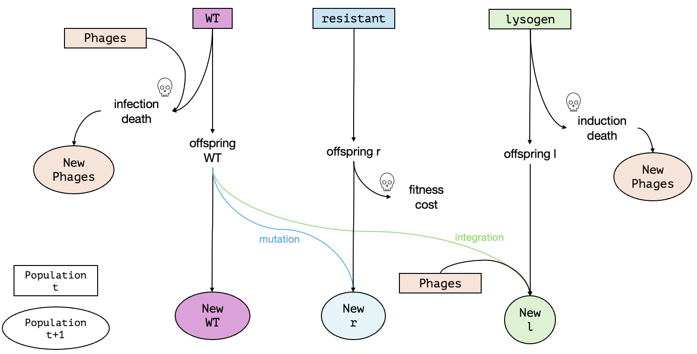

---
title: "Bacteria Evolutionary Rescue: Resistance or Lysogen"
author: "Aylin & Marika"
date: "2026-10-15"
output:
  html_document:
    df_print: paged
    ---

## Simulating evolutionary rescue in discrete time

In this notebook, we are implementing simulations of evolutionary rescue in a bacterial population under phage pressure. The model is based on a single-mutation, discrete-time framework, which we extended by a phage population and a second rescue strategy. The model is as follows: a haploid bacterial population starts with a given number of wild-type (wt) bacteria and together with a population of free phages. Because of the phages, the wild-type is unfit: in each generation wt bacteria are killed by phage infection and the more phages there are, the higher the death rate of the wild-type.
The following are the two possible survival strategies that the bacteria population have:

1. Resistance (slow but safe): wt offspring have a resistance mutation at a low rate (mut_rate). Resistant bacteria are immune to the phages and are not killed by infection. Resistance is permanent, but it comes with a fitness cost (cost_r) that reduces their offspring number. This strategy is phage-independent. 

2. Lysogen (fast but risky): wt bacteria can enter a lysogen relationship with the phage (lysogen_prob) and this becomes more likely the more phages are present. Lysogenic bacteria carry a dormant phage and therefore don't die from infection. However, they can later be killed when their own phage is induced (induction_prob), which releases new phages into the environment. This strategy is phage-dependent

So the following are the four possible outcomes of our model:
1.Extinction
2.Only lysogen persists
3.Only resistance persists
(4.Coexistence occurs --> not possible in our model)
(5.Only wt persists -> not possible)


All bacterial types grow with a shared carrying capacity (K) and the phage population is updated each generation from phage decline (P_decline) and from phage production at infection and induction events (P_prod). Resistant and lysogenic bacteria start at a population number of 0, so they have to arise from wt bacteria through mutations or integration (becoming a lysogen) and then spread before the bacterial population goes extinct. Rescue means that the bacterial population recovers and persists, so the central question is which strategy (resistance or lysogen) rescues the population and under which conditions.


### Model overview: strategies and outcomes

The model is as follows: a haploid bacterial population starts with a given number of wild-type (wt) bacteria and a fixed growth rate together with a population of free phages. Because of the phages, the wild-type is unfit: in each generation wt bacteria are killed by phage infection and the more phages there are, the higher the death rate of the wild-type.
The following are the two possible survival strategies that the bacteria population have:

1. Resistance (slow but safe): wt offspring have a resistance mutation at a low rate (`mut_rate`). Resistant bacteria are immune to the phages and are not killed by infection. Resistance is permanent, but it comes with a fitness cost (`cost_r`) that reduces their offspring number. This strategy is phage-independent. 

2. Lysogen (fast but risky): wt bacteria can enter a lysogenic relationship with the phage (`lysogen_prob`), which becomes more likely the more phages are present. Lysogenic bacteria carry a dormant phage and therefore cannot die from infection. However, they can later be killed by induction of the dormant phage (`induction_prob`), which releases new phages into the environment. This strategy is phage-dependent.

Figure 1 shows a schematic of one generation. Not depicted are the rates and probabilities leading to each new population (i.e., `growth_rate`, `mut_rate`, `cost_r`, `induction_prob` etc.). 


*Figure 1: Life cycle of one generation in the model with `cst`*

All bacterial types grow with a shared carrying capacity (`K`) and the phage population is updated each generation from phage decline (`P_decline`) and from phage production at infection and induction events (`P_prod`). Resistant and lysogenic bacteria start at a population number of 0, so they have to arise from wt bacteria through mutations or integration (i.e., becoming a lysogen) and then spread before the total bacterial population goes extinct. Rescue means that the bacterial population (be it wt, resistant or lysogen) recovers and persists. 

The following are the three possible outcomes of our model:
1. Extinction
2. Only lysogen persists
3. Only resistance persists

The central questions are a) whether the population is rescued and b) which strategy is more successful under which conditions.

## List of variables and parameters

| Name | Type | Description | Allowed range | Value |
|:-----|:-----|:------------|:--------------|:------|
| $N_{wt}$ | State variable | Current size of the wild-type bacteria population | integer ≥ 0 | changes over time |
| $N_r$ | State variable | Current size of the resistant bacteria population | integer ≥ 0 | changes over time |
| $N_l$ | State variable | Current size of the lysogenic bacteria population | integer ≥ 0 | changes over time |
| $N_P$ | State variable | Current size of the phage population | ≥ 0 | changes over time |
| `N_init_wt` | Initial condition | Initial size of the wild-type population | positive integer | 100 |
| `N_init_r` | Initial condition | Initial size of the resistant mutant population | integer ≥ 0 | 0 |
| `N_init_l` | Initial condition | Initial size of the lysogenic population | integer ≥ 0 | 0 |
| `N_init_P` | Initial condition | Initial size of the phage population | positive integer | 1 |
| `growth_rate` | Model parameter | Average number of offspring per bacterium (wt, r and l) per generation | ≥ 0 | 1.5 |
| `lysogen_prob` | Model parameter | Probability that a wt bacterium becomes lysogenic | 0 to 1 | 0.002 |
| `mut_rate` | Model parameter | Probability that an offspring of a wt bacterium mutates to resistant | 0 to 1 | 0.002 |
| `infection_prob` | Model parameter | Probability that a wt bacterium is infected by a phage per generation | 0 to 1 | 0.01 |
| `K` | Model parameter | Carrying capacity of the total bacteria population (wt + r + l) | positive integer | 2000 |
| `P_decline` | Model parameter | Fraction of phages decaying every generation (entered as a negative number) | ≤ 0 | -0.5 |
| `P_prod` | Model parameter | Number of new phages produced per infection or induction | ≥ 0 | 1.5 |
| `t_max` | Simulation setting | Number of generations after which the simulation stops (not a model parameter). The simulation also stops automatically if the bacterial population goes extinct | integer > 0 | 2000 |
| `induction_prob` | Varied parameter | Probability (per generation) that a lysogenic bacterium is killed by its own dormant phage | 0 to 1 | varied in the analysis |
| `cost_r` | Varied parameter | Fraction of offspring that resistant bacteria lose compared to wt (fitness cost of resistance) | 0 to 1 | varied in the analysis |

```{r setup, include=FALSE}
knitr::opts_chunk$set(echo = TRUE)
your_pathname = "/Users/macbookair/Library/CloudStorage/OneDrive-Personal/THEE prakti/THEE Coevolution"

library(ggplot2)
library(tidyr)
library(dplyr)
library(tibble)
```

## R Markdown

This is an R Markdown document. Markdown is a simple formatting syntax for authoring HTML, PDF, and MS Word documents. For more details on using R Markdown see <http://rmarkdown.rstudio.com>.

When you click the **Knit** button a document will be generated that includes both content as well as the output of any embedded R code chunks within the document. You can embed an R code chunk like this:

```{r cars}
summary(cars)
```

## Including Plots
```{r fig.cap = "Fig. 2: Extinciton probability with varying cost_r and induction_prob"}

# get data
# if you want to access data from an earlier simulation, set the date to the day it was created (format YYYY-MM-DD) 
date = Sys.Date()
outcomes = read.csv(paste(your_pathname, "/data/combined_r_l_data", date, ".csv", sep = ""))

## plot outcomes

# treat parameters as a categorical axis
outcomes$induction_prob <- factor(outcomes$induction_prob)
outcomes$cost_r = factor(outcomes$cost_r)

# fix the order of the five outcomes so colours are consistent
outcomes$outcome <- factor(outcomes$outcome,
  levels = c("extinction", "wt wins", "r wins", "l wins", "temporary coexistence"))

## heat map for extinction (Claude)
library(dplyr)

# extinction probability per parameter combination
ext <- outcomes %>%
  dplyr::group_by(induction_prob, cost_r) %>%
  dplyr::summarise(p_ext = mean(outcome == "extinction"),
            n_runs = n(),
            .groups = "drop")

ggplot(ext, aes(x = cost_r, y = induction_prob, fill = p_ext)) +
  geom_tile(colour = "white", linewidth = 0.8) +
  geom_text(aes(label = sprintf("%.2f", p_ext)), size = 4) +
  scale_fill_gradient(low = "white", high = "#D55E00",
                      limits = c(0, 1), name = "P(extinction)") +
  labs(x = "Cost of resistance (cost_r)",
       y = "Induction probability (induction_prob)") +
  coord_equal() +
  theme_minimal() +
  ggtitle("Probability of extinction")

```
```{r cost_r iterations, echo = F}
# set some parameters to fixed values
# set t_max to a value to be used throughout
max_gen <- 2000

N_init_wt <- 100
N_init_r <- 0
N_init_l <- 0
N_init_p <- 1
infection_prob <- 0.01
lysogen_prob <- 0.002
growth_rate <- 1.5
mut_rate <- 0.002
K <- 1000
P_decline <- -0.5
P_prod <- 1.5

# determine how often to run the simulation for each set of parameters
no_replicates <- 100

# set parameters to vary
induction_prob = 0.46
cost_r = seq(0.05, 0.95, by = 0.15)

# initialize data table - where to collect the results
 data_table <- c()

 # set seed for reproducibility
 set.seed(10)

# run the simulation across  chosen parameter: cost_r
  # loop over selection coefficients
  for(cval in cost_r){
    # different way of running many simulations: make replicates using "repeat" function with a counter i
    # reset counter
    i<-1
    repeat {
      # increase counter by one
      i<-i+1
      # set seed inside loop to recreate single trajectories. for debugging/checking only
      #set.seed(i) 
      seed = i
      # run the simulation once with changing parameter
      one_run <- simulate_pop(N_init_wt, N_init_r, N_init_l, N_init_p, infection_prob, induction_prob, lysogen_prob, mut_rate, cval, growth_rate, max_gen, K, P_decline, P_prod)
      
      # Record population sizes at the final simulated generation
      final_sizes <- as.numeric(tail(one_run, 1))
      
      # add current result of current iteration to datatable
      data_table <- rbind(data_table,c(cval,final_sizes[1],final_sizes[2],final_sizes[3],final_sizes[4], seed )) # note that we add the varying parameters to the table too

      # stop the repeated computation after no_replicates times
      if(i>no_replicates) break
    }
}
# define column names of data table
colnames(data_table) <- c("cost_r", "wt", "r", "l", "p", "seed")
# show the first lines of the output
print(head(data_table))


## determine outcomes
# convert to dataframe
outcomes = as.data.frame(data_table)
outcomes$outcome <- NA_character_

for (i in seq_len(nrow(outcomes))) {
  wt <- outcomes[i, "wt"]
  r  <- outcomes[i, "r"]
  l  <- outcomes[i, "l"]
  seed = outcomes [i, "seed"]

  if (wt == 0 & r == 0 & l == 0) {
    outcomes$outcome[i] <- "extinction"
  } else if (wt > 0 & r == 0 & l == 0) {
    outcomes$outcome[i] <- "wt wins"
  } else if (r > 0 & wt == 0 & l == 0) {
    outcomes$outcome[i] <- "r wins"
  } else if (l > 0 & wt == 0 & r == 0) {
    outcomes$outcome[i] <- "l wins"
  } else {
    outcomes$outcome[i] <- "temporary coexistence"
  }
}

print(head(outcomes))

# save data with today's date. any data generated on the same date will overwrite this file
write.csv(outcomes, paste(your_pathname, "/data/cost_r_iterations_lowK", Sys.Date(), ".csv", sep = ""))
```


```{r cost_r iterations plots, echo = F}
## plot outcomes of cost_r iterations

# get data
# if you want to access data from an earlier simulation, set the date to the day it was created (format YYYY-MM-DD), otherwise use Sys.Date()
date = Sys.Date()
outcomes = read.csv(paste(your_pathname, "/data/cost_r_iterations_lowK", date, ".csv", sep = ""))

# treat cost_r as a categorical axis 
outcomes$cost_r <- factor(outcomes$cost_r)

# fix the order of the five outcomes so colours are consistent
outcomes$outcome <- factor(outcomes$outcome,
  levels = c("extinction", "wt wins", "r wins", "l wins", "temporary coexistence"))

# define colors
pal <- c("extinction"            = "grey50",
         "wt wins"               = "#E69F00",
         "r wins"                = "#0072B2",
         "l wins"                = "#009E73",
         "temporary coexistence" = "#F0E442")

# proportion of each outcome per cost_r
props <- outcomes %>%
  count(cost_r, outcome, .drop = FALSE) %>%
  group_by(cost_r) %>%
  mutate(prop = n / sum(n)) %>%
  ungroup() %>%
  filter(n > 0)          # no labels for outcomes that never occur

# barplot with percentage labels
props <- tidyr::complete(props, cost_r, outcome, fill = list(prop = 0))
ggplot(props, aes(x = cost_r, y = prop, fill = outcome)) +
  geom_col(position = position_fill(reverse = TRUE)) +
  geom_text(aes(label = ifelse(prop > 0, scales::percent(prop, accuracy = 1), ""),
                colour = outcome == "r wins",
                group = outcome),
            position = position_fill(vjust = 0.5, reverse = TRUE),
            size = 3.5, show.legend = FALSE) +
  scale_colour_manual(values = c("TRUE" = "white", "FALSE" = "black")) +
  scale_y_continuous(labels = scales::percent) +
  scale_fill_manual(values = pal, drop = FALSE) +
  labs(x = "Cost of resistance (cost_r)",
       y = "Proportion of replicates",
       fill = "Outcome") +
  theme_minimal() +
  ggtitle("Outcome proportions with different cost_r and K = 1000")
```
```{r induction_prob iterations, echo = F}
# set some parameters to fixed values
# set t_max to a value to be used throughout
max_gen <- 2000

N_init_wt <- 100
N_init_r <- 0
N_init_l <- 0
N_init_p <- 1
infection_prob <- 0.01
lysogen_prob <- 0.002
growth_rate <- 1.7
mut_rate <- 0.0005 
K <- 1000
P_decline <- -0.5
P_prod <- 1.5

# determine how often to run the simulation for each set of parameters
no_replicates <- 100

# set parameters to vary
induction_prob = seq(0.05, 0.95, by = 0.15)
cost_r = 0.1

# initialize data table - where to collect the results
 data_table <- c()

 # set seed for reproducibility
  set.seed(10)

# run the simulation across  chosen parameter: induction_prob
  # loop over selection coefficients
  for(ival in induction_prob){
    # different way of running many simulations: make replicates using "repeat" function with a counter i
    # reset counter
    i<-1
    repeat {
      # increase counter by one
      i<-i+1
       # set seed inside loop to recreate single trajectories. for debugging/checking only
      #set.seed(i) 
      seed = i
      # run the simulation once with changing parameter
      one_run <- simulate_pop(N_init_wt, N_init_r, N_init_l, N_init_p, infection_prob, ival, lysogen_prob, mut_rate, cost_r, growth_rate, max_gen, K, P_decline, P_prod)
      
      # Record population sizes at the final simulated generation
      final_sizes <- as.numeric(tail(one_run, 1))
      
      # add current result of current iteration to datatable
      data_table <- rbind(data_table,c(ival,final_sizes[1],final_sizes[2],final_sizes[3],final_sizes[4], seed )) # note that we add the varying parameters to the table too

      # stop the repeated computation after no_replicates times
      if(i>no_replicates) break
    }
}
# define column names of data table
colnames(data_table) <- c("induction_prob", "wt", "r", "l", "p", "seed")
# show the first lines of the output
print(head(data_table))


## determine outcomes
# convert to dataframe
outcomes = as.data.frame(data_table)
outcomes$outcome <- NA_character_

for (i in seq_len(nrow(outcomes))) {
  wt <- outcomes[i, "wt"]
  r  <- outcomes[i, "r"]
  l  <- outcomes[i, "l"]
  seed = outcomes [i, "seed"]

  if (wt == 0 & r == 0 & l == 0) {
    outcomes$outcome[i] <- "extinction"
  } else if (wt > 0 & r == 0 & l == 0) {
    outcomes$outcome[i] <- "wt wins"
  } else if (r > 0 & wt == 0 & l == 0) {
    outcomes$outcome[i] <- "r wins"
  } else if (l > 0 & wt == 0 & r == 0) {
    outcomes$outcome[i] <- "l wins"
  } else {
    outcomes$outcome[i] <- "temporary coexistence"
  }
}

print(head(outcomes))

# save data with today's date. any data generated on the same date will overwrite this file
write.csv(outcomes, paste(your_pathname, "/data/induction_prob_iterations_lowK", Sys.Date(), ".csv", sep = ""))
```


```{r induction_prob iterations plots, echo = F}
## plot outcomes of induction_prob iterations

# get data
# if you want to access data from an earlier simulation, set the date to the day it was created (format YYYY-MM-DD), otherwise use Sys.Date()
date = Sys.Date()
outcomes = read.csv(paste(your_pathname, "/data/induction_prob_iterations_lowK", date, ".csv", sep = ""))

# treat induction_prob as a categorical axis
outcomes$induction_prob <- factor(outcomes$induction_prob)

# fix the order of the five outcomes so colours are consistent
outcomes$outcome <- factor(outcomes$outcome,
  levels = c("extinction", "wt wins", "r wins", "l wins", "temporary coexistence"))

# define colors
pal <- c("extinction"            = "grey50",
         "wt wins"               = "#E69F00",
         "r wins"                = "#0072B2",
         "l wins"                = "#009E73",
         "temporary coexistence" = "#F0E442")

# proportion of each outcome per induction_prob
props <- outcomes %>%
  count(induction_prob, outcome, .drop = FALSE) %>%
  group_by(induction_prob) %>%
  mutate(prop = n / sum(n)) %>%
  ungroup() %>%
  filter(n > 0)          # no labels for outcomes that never occur

# barplot with percentage labels
props$outcome <- factor(props$outcome, levels = names(pal))
props <- tidyr::complete(props, induction_prob, outcome, fill = list(prop = 0))
ggplot(props, aes(x = induction_prob, y = prop, fill = outcome)) +
  geom_col(position = position_fill(reverse = TRUE)) +
  geom_text(aes(label = ifelse(prop > 0, scales::percent(prop, accuracy = 1), ""),
                colour = outcome == "r wins",
                group = outcome),
            position = position_fill(vjust = 0.5, reverse = TRUE),
            size = 3.5, show.legend = FALSE) +
  scale_colour_manual(values = c("TRUE" = "white", "FALSE" = "black")) +
  scale_y_continuous(labels = scales::percent) +
  scale_fill_manual(values = pal, drop = FALSE) +
  labs(x = "Induction probability (induction_prob)",
       y = "Proportion of replicates",
       fill = "Outcome") +
  theme_minimal() +
  ggtitle("Outcome proportions with different induction_prob and K = 1000")

### Effect of lower K
```{r cost_r LOW K iterations plots, echo = F}
## plot outcomes of cost_r iterations

# get data
# if you want to access data from an earlier simulation, set the date to the day it was created (format YYYY-MM-DD), otherwise use Sys.Date()
date = "2026-11-05"
outcomes = read.csv(paste(your_pathname, "/data/cost_r_iterations_lowK", date, ".csv", sep = ""))

# treat cost_r as a categorical axis 
outcomes$cost_r <- factor(outcomes$cost_r)

# fix the order of the five outcomes so colours are consistent
outcomes$outcome <- factor(outcomes$outcome,
  levels = c("extinction", "wt wins", "r wins", "l wins", "temporary coexistence"))

# define colors
pal <- c("extinction"            = "grey50",
         "wt wins"               = "#E69F00",
         "r wins"                = "#0072B2",
         "l wins"                = "#009E73",
         "temporary coexistence" = "#F0E442")

# proportion of each outcome per cost_r
props <- outcomes %>%
  count(cost_r, outcome, .drop = FALSE) %>%
  group_by(cost_r) %>%
  mutate(prop = n / sum(n)) %>%
  ungroup() %>%
  filter(n > 0)          # no labels for outcomes that never occur

# barplot with percentage labels
props <- tidyr::complete(props, cost_r, outcome, fill = list(prop = 0))
ggplot(props, aes(x = cost_r, y = prop, fill = outcome)) +
  geom_col(position = position_fill(reverse = TRUE)) +
  geom_text(aes(label = ifelse(prop > 0, scales::percent(prop, accuracy = 1), ""),
                colour = outcome == "r wins",
                group = outcome),
            position = position_fill(vjust = 0.5, reverse = TRUE),
            size = 3.5, show.legend = FALSE) +
  scale_colour_manual(values = c("TRUE" = "white", "FALSE" = "black")) +
  scale_y_continuous(labels = scales::percent) +
  scale_fill_manual(values = pal, drop = FALSE) +
  labs(x = "Cost of resistance (cost_r)",
       y = "Proportion of replicates",
       fill = "Outcome") +
  theme_minimal() +
  ggtitle("Outcome proportions with different cost_r and K = 1000")
```
*Supplementary Figure 9: Barplot of outcome proportions of 100 simulation replicates with varying `cost_r`, `K` = 1000, `induction_prob`= 0.46 and set model parameters (see model overview)*


```{r induction_prob LOW K iterations plots, echo = F}
## plot outcomes of induction_prob iterations

# get data
# if you want to access data from an earlier simulation, set the date to the day it was created (format YYYY-MM-DD), otherwise use Sys.Date()
date = Sys.Date()
outcomes = read.csv(paste(your_pathname, "/data/induction_prob_iterations_lowK", date, ".csv", sep = ""))

# treat induction_prob as a categorical axis
outcomes$induction_prob <- factor(outcomes$induction_prob)

# fix the order of the five outcomes so colours are consistent
outcomes$outcome <- factor(outcomes$outcome,
  levels = c("extinction", "wt wins", "r wins", "l wins", "temporary coexistence"))

# define colors
pal <- c("extinction"            = "grey50",
         "wt wins"               = "#E69F00",
         "r wins"                = "#0072B2",
         "l wins"                = "#009E73",
         "temporary coexistence" = "#F0E442")

# proportion of each outcome per induction_prob
props <- outcomes %>%
  count(induction_prob, outcome, .drop = FALSE) %>%
  group_by(induction_prob) %>%
  mutate(prop = n / sum(n)) %>%
  ungroup() %>%
  filter(n > 0)          # no labels for outcomes that never occur

# barplot with percentage labels
props$outcome <- factor(props$outcome, levels = names(pal))
props <- tidyr::complete(props, induction_prob, outcome, fill = list(prop = 0))
ggplot(props, aes(x = induction_prob, y = prop, fill = outcome)) +
  geom_col(position = position_fill(reverse = TRUE)) +
  geom_text(aes(label = ifelse(prop > 0, scales::percent(prop, accuracy = 1), ""),
                colour = outcome == "r wins",
                group = outcome),
            position = position_fill(vjust = 0.5, reverse = TRUE),
            size = 3.5, show.legend = FALSE) +
  scale_colour_manual(values = c("TRUE" = "white", "FALSE" = "black")) +
  scale_y_continuous(labels = scales::percent) +
  scale_fill_manual(values = pal, drop = FALSE) +
  labs(x = "Induction probability (induction_prob)",
       y = "Proportion of replicates",
       fill = "Outcome") +
  theme_minimal() +
  ggtitle("Outcome proportions with different induction_prob and K = 1000")

```
*Supplementary Figure 10: Barplot of outcome proportions of 100 simulation replicates with varying `induction_prob`, `K`= 1000, `cost_r`= 0.1 and set model parameters (see model overview)*


```